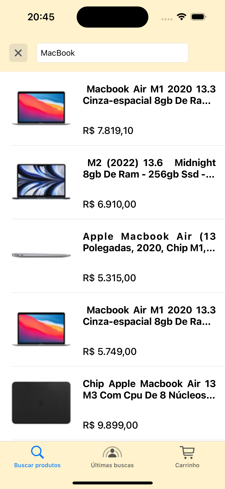
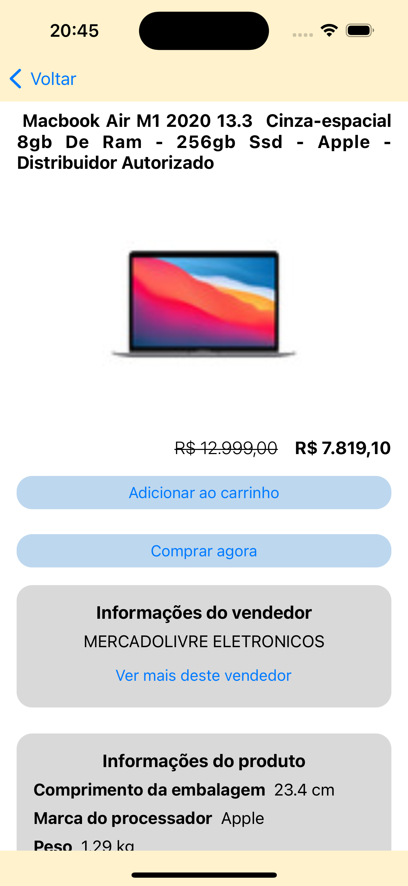
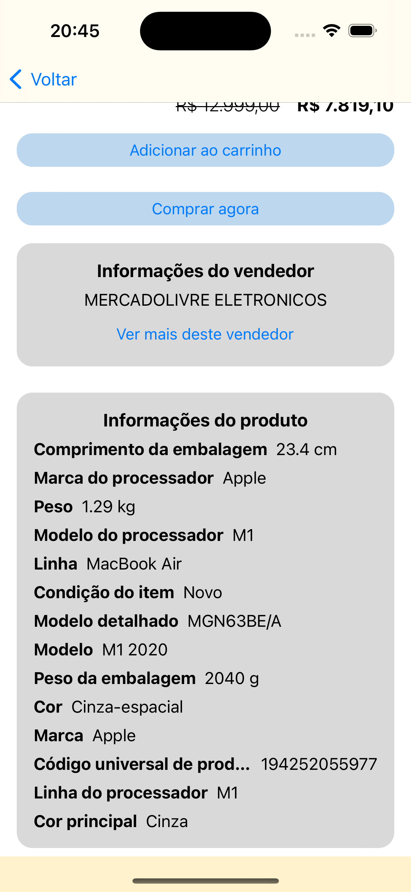
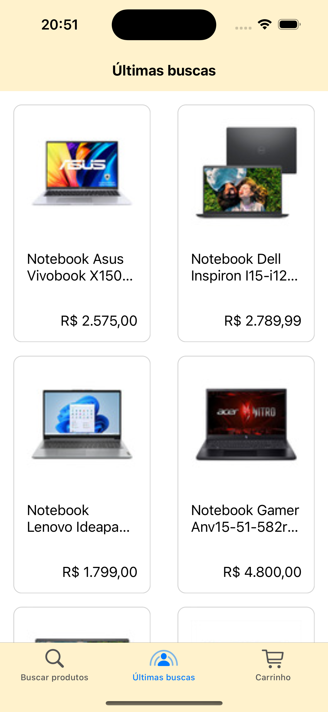
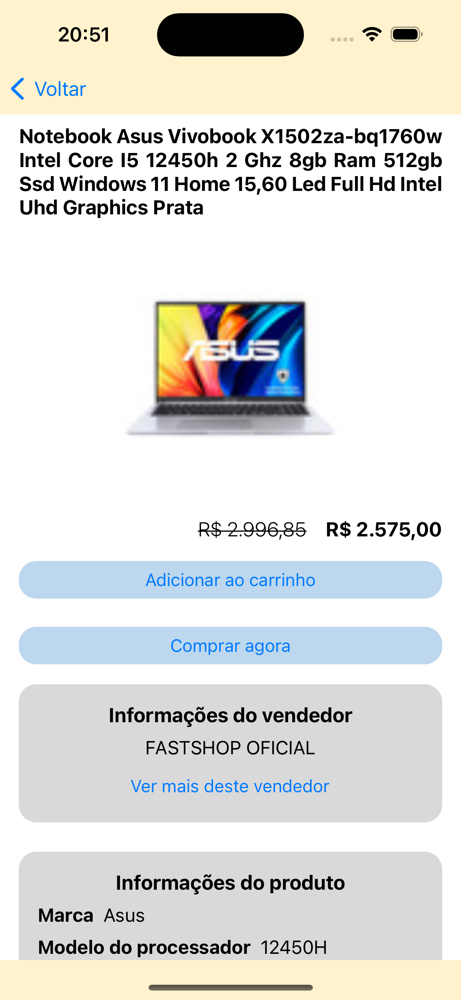
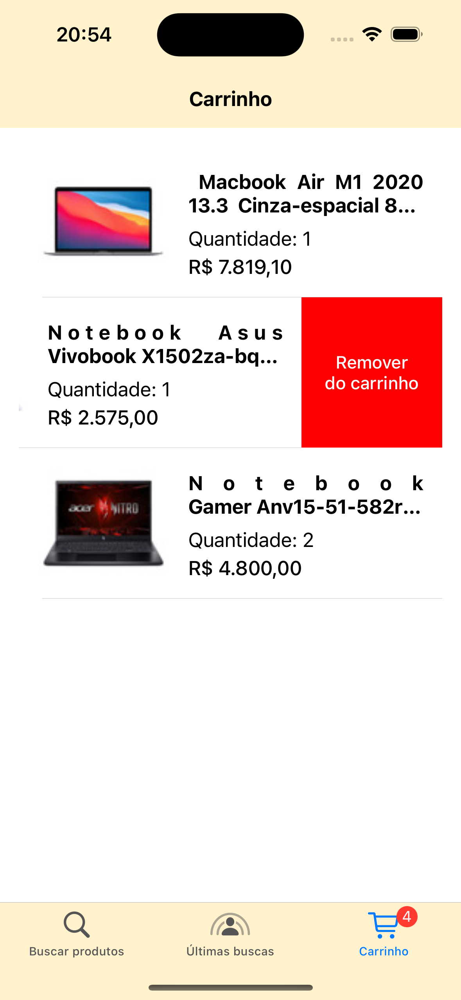
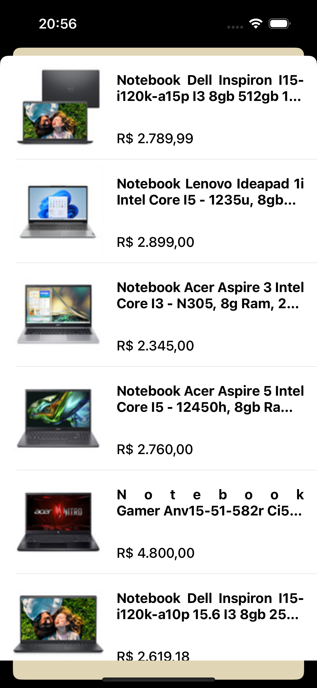
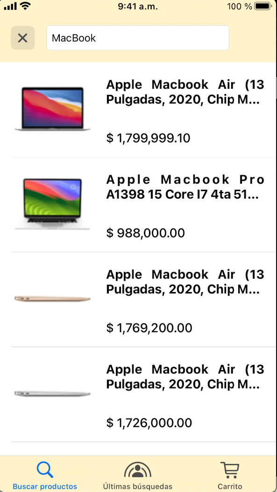

# Mercado Libre Mobile Candidate

Projeto desenvolvido durante processo seletivo para vaga de iOS Software Engineer (Nativo), onde o objetivo é a construção de uma aplicação capaz de realizar buscas e ver detalhes dos produtos utilizando API disponibilizada.

Confira os requisitos clicando [aqui](requirements.md)
## Funcionalidades

- Busca de produtos:
  - Nessa tela o usuário pode realizar a busca de produtos, abrir os detalhes, visualizar mais itens do vendedor e adicionar ao carrinho.
<div style="display: flex; justify-content: center;">
    
    
    
</div>

- Últimas buscas:
  - Nessa tela são apresentados ao usuário produtos da mesma categoria que a sua ultima busca, também é possível ver detalhes, visualizar mais itens do vendedor e adicionar ao carrinho.
<div style="display: flex; justify-content: center;">
    
    
</div>

- Carrinho:
  - Nessa tela são apresentados todos os itens que o usuário colocou no carrinho unificando os produtos por id e mostrando sua quantidade, também é possível realizar a deleção ao arrastar para o lado.
<div style="display: flex; justify-content: center;">
    
</div>

- Itens do vendedor:
  - Em todas as telas de detalhe do produto é possível acessar mais itens do vendedor.
<div style="display: flex; justify-content: center;">
    
</div>

- Site ID personalizado:
  - Caso o usuário tenha seu celular configurado em espanhol, todas as buscas são realizadas utilizando o site id MLA (Argentina).
<div style="display: flex; justify-content: center;">
    
</div>

Se quiser ver o funcionamento completo em vídeo [clique aqui](https://youtu.be/Q1vpbZNz1SY)

## Como executar o projeto

Clone o repositório:
```
git clone git@github.com:christianalexandre/ml-challenge.git
```
Navegue para a pasta clonada e depois para 'ml-challenge'
```
cd diretório-criado/ml-challenge
```
Abra o xcodeproj
```
 open ml-challenge.xcodeproj
```
Aguarde as dependências (SPM) sincronizarem e rode o projeto.

Você também pode baixar instalar o ipa diretamente no seu iOS escaneando o QR abaixo:
<div style="display: flex; justify-content: center;">
    
</div>

## Desenvolvido com

- Xcode
- Swift
- RxSwift
- AlamoFire
- RxAlamoFire
- Postman

Para baixar a collection do postman utilizada [clique aqui](./assets/ML.postman_collection.json)
## Autor

* **Christian Alberton Alexandre** - [Linkedin](https://www.linkedin.com/in/christian-alexandre/)

